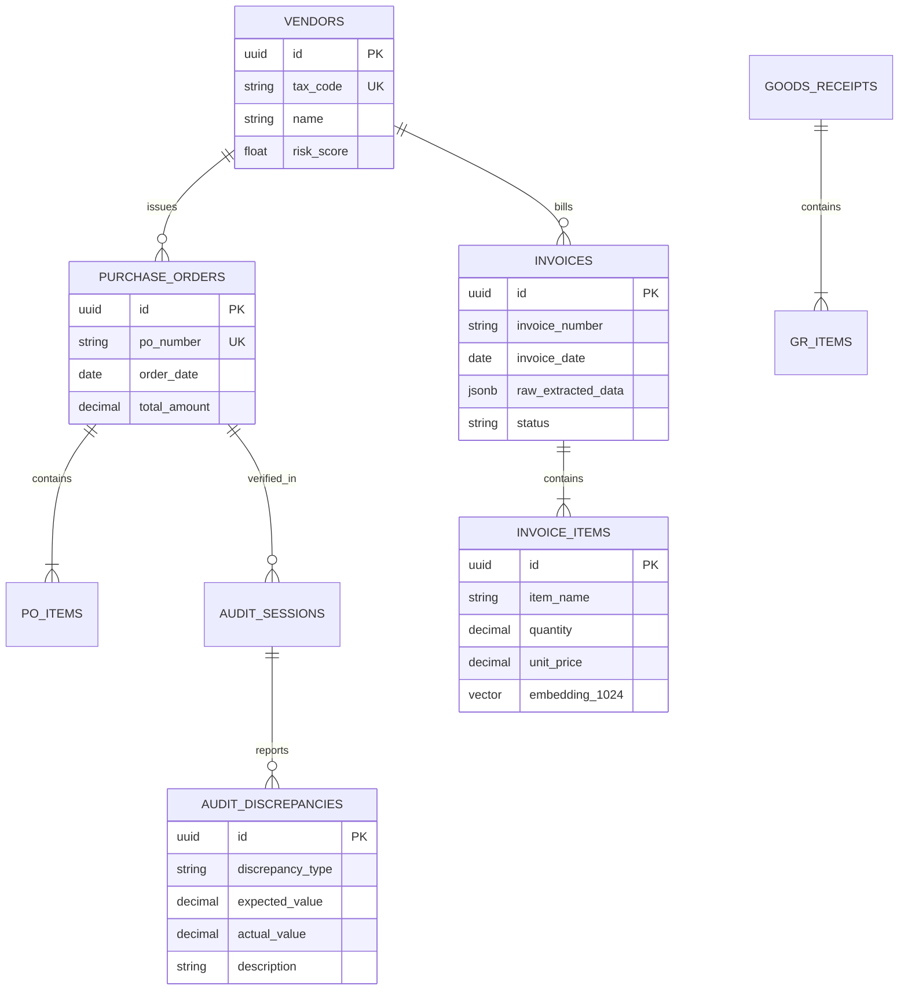

# 🛡️ AuditGuard-AI
> **Autonomous 3-Way Matching & Financial Document Audit Agent (100% On-Premise)**  
> *Nền tảng AI Agent Tự động hóa Đối soát Chứng từ 3 Chiều & Kiểm soát Rủi ro Mua hàng cho Doanh nghiệp.*

---

[](https://opensource.org/licenses/MIT)
[](https://dotnet.microsoft.com/)
[](https://react.dev/)
[](https://ollama.com/)
[](https://github.com/PaddlePaddle/PaddleOCR)
[](https://github.com/pgvector/pgvector)
[](#-data-privacy--enterprise-security)

---

## 📌 Executive Summary (Tổng quan giải pháp)

Trong quy trình mua sắm và quản lý tài chính doanh nghiệp, **Đối soát 3 chiều (3-Way Matching)** giữa **Đơn đặt hàng (Purchase Order - PO)**, **Phiếu nhập kho (Goods Receipt Note - GRN)** và **Hóa đơn tài chính (VAT Invoice)** là phòng tuyến tối quan trọng để ngăn chặn thất thoát dòng tiền. Tuy nhiên, quy trình này hiện vẫn được thực hiện thủ công, tốn hàng trăm giờ làm việc mỗi tháng và tiềm ẩn sai sót lớn do con người.

**AuditGuard-AI** là nền tảng **Trợ lý Kiểm toán số (Autonomous Audit Agent)** thế hệ mới, vận hành **100% Local (On-Premise / Edge AI)**. Hệ thống kết hợp sức mạnh của **Document Vision AI**, **Mô hình Ngôn ngữ Lớn (LLM Qwen 2.5)** và **Vector Semantic Matching** cùng bộ quy tắc kiểm định toán học tất định để:
1. Đọc hiểu và bóc tách tự động dữ liệu hóa đơn/chứng từ đa định dạng (PDF, Scan, Ảnh chụp).
2. Đồng nhất danh pháp sản phẩm bị lệch tên giữa các bên.
3. Tự động kiểm tra chéo số lượng, đơn giá, thuế suất, phát hiện hóa đơn trùng lặp và cảnh báo sai lệch theo thời gian thực.

---

## 💥 The Business Problem & ROI (Bài toán kinh doanh)

### Nỗi đau thực tế của Doanh nghiệp (Pain Points)
* **Tốn kém nhân lực:** Kế toán mất trung bình **15 - 20 phút** để dò từng dòng sản phẩm trên một bộ chứng từ mua hàng.
* **Thất thoát tài chính do sai lệch ngầm:** Nhà cung cấp vô tình hoặc cố ý tăng đơn giá so với hợp đồng khung, giao thiếu số lượng so với hóa đơn xuất.
* **Rủi ro hóa đơn trùng lặp & Pháp lý:** Thanh toán hai lần cho cùng một đợt hàng; nguy cơ dính hóa đơn từ doanh nghiệp bị cưỡng chế thuế.
* **Rào cản bảo mật dữ liệu:** Doanh nghiệp không thể tải hóa đơn và số liệu kinh doanh lên các dịch vụ Cloud API công cộng (OpenAI, Anthropic) do vi phạm chính sách bảo mật nội bộ.

### Giá trị mang lại (Business ROI)
| Chỉ số | Quy trình truyền thống | Với AuditGuard-AI | Hiệu quả cải thiện |
| :--- | :--- | :--- | :--- |
| **Thời gian đối soát** | 15 - 20 phút / bộ | **< 5 giây / bộ** | **Nhanh hơn 95%** |
| **Chi phí nhân sự** | 1-2 kế toán chuyên trách | 1 người duyệt bán tự động | **Tiết kiệm 70% chi phí** |
| **Tỷ lệ sai sót / Gian lận** | ~3 - 5% tổng giá trị chi | Tiệm cận **0%** | Ngăn chặn thất thoát 100% |
| **Bảo mật dữ liệu** | Nguy cơ rò rỉ nếu dùng Cloud | **100% On-Premise** | Tuyệt đối an toàn nội bộ |

---

## ✨ Core Features (Tính năng nổi bật)

* 🔒 **100% On-Premise & Zero Data Leakage:** Toàn bộ quá trình OCR, suy luận LLM và đối soát dữ liệu diễn ra hoàn toàn trên máy chủ/máy trạm nội bộ, không phụ thuộc kết nối Internet.
* 📄 **Multi-modal Document Ingestion:** Tự động đọc và chuẩn hóa dữ liệu từ PDF điện tử, file ảnh scan, ảnh chụp xiên góc bằng **PaddleOCR v4**.
* 🧠 **LLM Structured Extraction:** Sử dụng **Qwen 2.5:7B** cục bộ qua Ollama để chuyển đổi văn bản OCR phi cấu trúc thành dữ liệu JSON chuẩn xác 100%.
* 🎯 **Semantic Entity Resolution:** Tự động liên kết các mặt hàng bị lệch danh pháp (Ví dụ: *"Mực in HP 85A"* $\leftrightarrow$ *"Hộp mực laser CE285A"*) nhờ mô hình Vector Embeddings **bge-m3**.
* ⚖️ **Deterministic 3-Way Matching:** Kiểm tra chéo 3 chiều nghiêm ngặt (PO vs Kho vs Hóa đơn) về Số lượng, Đơn giá, Thuế VAT và Thành tiền.
* 🚩 **Real-time Anomaly & Fraud Detection:** Phát hiện trùng lặp mã số hóa đơn, chênh lệch đơn giá vượt ngưỡng cho phép, hóa đơn xuất trước ngày lập đơn đặt hàng.
* ✉️ **One-click Dispute Resolution:** Tự động soạn thảo văn bản/email phản hồi gửi nhà cung cấp kèm bằng chứng sai lệch chỉ với 1 cú click.

---

## 🏗️ System Architecture (Kiến trúc hệ thống)

Hệ thống được xây dựng theo kiến trúc **Modular Monolith** kết hợp **Asynchronous Processing Pipeline**:

```
[ B2B Web Client (React + Tailwind CSS) ]
                   │
                   ▼  HTTP REST / WebSocket (SignalR)
[ Core API Gateway (.NET 8 Clean Architecture) ]
  ├── Auth & Tenancy Module
  ├── Document Storage (Local Encrypted Storage)
  ├── Job Queue Dispatcher (InMemory Channels / Redis)
  └── Audit Engine & Business Rule Validator
                   │
                   ▼  Job Stream
[ AI Worker Service (Python 3.11) ]
  ├── Stage 1: Local OCR Engine (PaddleOCR / PyMuPDF)
  ├── Stage 2: Structural JSON Extractor (Ollama - Qwen 2.5:7B)
  └── Stage 3: Vector Embedding Generator (bge-m3)
                   │
                   ▼  Persistence & Similarity Query
[ PostgreSQL 16 + pgvector Extension ]
  ├── Relational Tables (ACID Financial Data)
  ├── JSONB Stores (Raw OCR Documents)
  └── HNSW / IVFFlat Indexes (High-Speed Cosine Matching)
```

---

## 🛠️ Tech Stack (Công nghệ sử dụng)

### Frontend
* **Core:** React 18, TypeScript, Vite.
* **Styling & UI:** Tailwind CSS, Lucide Icons, Headless UI.
* **Document Viewer:** `pdfjs-dist` (hỗ trợ xem trước và highlight vùng lỗi trực tiếp trên file PDF).
* **Real-time Communication:** `@microsoft/signalr` (nhận tiến trình bóc tách và cảnh báo thời gian thực).

### Backend
* **Framework:** ASP.NET Core Web API (.NET 8 LTS).
* **Architecture:** Clean Architecture (Domain-Driven Design light).
* **ORM:** Entity Framework Core 8.
* **Background Worker:** `IHostedService` & `System.Threading.Channels` (xử lý hàng đợi bất đồng bộ non-blocking).

### AI & Machine Learning Pipeline (100% Local)
* **Inference Server:** [Ollama](https://ollama.com/) (Local LLM Runtime).
* **Language Model:** `Qwen 2.5:7B-Instruct` (hoặc `Qwen 2.5:3B` cho máy cấu hình tiết kiệm).
* **OCR Engine:** `PaddleOCR v4` (tối ưu hóa nhận diện tiếng Việt và bảng biểu phức tạp).
* **Semantic Embeddings:** `sentence-transformers` với model `BAAI/bge-m3` (1024 dimensions).

### Database & Storage
* **Primary DB:** PostgreSQL 16.
* **Vector Search Extension:** `pgvector` (hỗ trợ tìm kiếm vector Cosine Similarity trực tiếp bằng SQL).
* **Cache & Message Broker (Optional):** Redis.

---

## 🗄️ Database Schema (Thiết kế CSDL)



---

## 🚀 Quick Start Guide (Hướng dẫn cài đặt & Khởi chạy)

### Yêu cầu hệ thống (Prerequisites)
* **HĐH:** Windows 10/11, Ubuntu 22.04+ hoặc macOS.
* **RAM:** Tối thiểu 8GB RAM (Khuyến nghị 16GB).
* **Phần mềm cần cài đặt:**
  - [Docker Desktop](https://www.docker.com/products/docker-desktop/) (cho PostgreSQL 16 + pgvector)
  - [.NET 8 SDK](https://dotnet.microsoft.com/download/dotnet/8.0)
  - [Node.js 20+ / 22+](https://nodejs.org/)
  - [Python 3.10+](https://www.python.org/)
  - [Ollama](https://ollama.com/) (Chạy AI LLM On-Premise)

---

### Bảng Ánh xạ Cổng Dịch vụ (Port Mapping)

| Dịch vụ | Cổng (Port) | Đường dẫn truy cập | Ghi chú |
| :--- | :--- | :--- | :--- |
| **Web Dashboard** | `3000` | [http://localhost:3000](http://localhost:3000) | Giao diện React 18 + Vite (Đã cấu hình proxy `/api` sang port 5000) |
| **Backend API** | `5000` | [http://localhost:5000](http://localhost:5000) | .NET 8 Web API, SignalR Hub `/hubs/audit`, Swagger `/swagger` |
| **AI Engine** | `8000` | [http://localhost:8000](http://localhost:8000) | FastAPI Microservice, Tài liệu tương tác `/docs` |
| **Ollama Service** | `11434` | [http://localhost:11434](http://localhost:11434) | Quản lý và thực thi mô hình LLM Local |
| **PostgreSQL DB** | `5432` | `localhost:5432` | CSDL lưu trữ chứng từ và vector embeddings pgvector |

---

### Cách 1: Khởi chạy 1-Click Trực tiếp từ Thư mục Gốc (Khuyến nghị)

Mở 3 cửa sổ Terminal tại thư mục gốc của dự án (`AuditGuard-AI/`):

#### Bước 0: Khởi động Cơ sở dữ liệu PostgreSQL + pgvector
```bash
docker compose up -d postgres
```
*(Lệnh này tự động kích hoạt container PostgreSQL 16 với pgvector và nạp sẵn schema từ `docker/01-init.sql`)*.

#### Terminal 1: Khởi chạy Backend (.NET 8 Web API & Background Worker)
```bash
dotnet run
```
* Backend tự động lắng nghe tại `http://localhost:5000` và kết nối với PostgreSQL.
* Swagger UI tra cứu API tại: `http://localhost:5000/swagger`.

#### Terminal 2: Khởi chạy AI Engine (Tự động hóa 100%)
```bash
python main.py
```
* **Tự động hóa hoàn toàn:** Script sẽ tự động kiểm tra dependencies (tự `pip install` nếu thiếu), tự động bật `ollama serve` ở chế độ ngầm nếu chưa chạy, kiểm tra và tự kéo model `qwen2.5:3b`, sau đó khởi động FastAPI tại `http://localhost:8000`.

#### Terminal 3: Khởi chạy Giao diện Web Dashboard (React 18 + Vite)
```bash
npm run dev
```
* Web Dashboard sẵn sàng tại: `http://localhost:3000`.

---

### Cách 2: Khởi chạy Thủ công Từng Dịch vụ (Dành cho Debug / Phát triển chi tiết)

<details>
<summary><b>Xem chi tiết các bước chạy thủ công từng phần</b></summary>

#### 1. Khởi động PostgreSQL qua Docker:
```bash
docker compose up -d postgres
```

#### 2. Khởi động Ollama & Tải mô hình Qwen 2.5:
```bash
ollama serve
ollama pull qwen2.5:3b
```

#### 3. Khởi chạy AI Engine Service:
```bash
cd ai-engine
pip install -r requirements.txt
python -m uvicorn main:app --host 0.0.0.0 --port 8000 --reload
```

#### 4. Khởi chạy Backend Web API:
```bash
dotnet run --project server/src/AuditGuard.Api
# hoặc đứng tại thư mục server/src/AuditGuard.Api rồi chạy 'dotnet run'
```

#### 5. Khởi chạy Frontend Web:
```bash
cd client
npm install
npm run dev
```
Truy cập giao diện tại: `http://localhost:3000`.

</details>

---

## 📂 Project Structure (Cấu trúc thư mục)

```text
AuditGuard-AI/
├── client/                     # Web Dashboard (React 18 + Vite + Tailwind)
│   ├── src/
│   │   ├── components/         # Split-screen viewer, Audit Table, Badges
│   │   ├── hooks/              # SignalR streaming hooks
│   │   └── pages/              # Upload, Dashboard, Discrepancy Detail
├── server/                     # Backend API (.NET 8 Clean Architecture)
│   ├── AuditGuard.Api/         # Controllers & WebSockets
│   ├── AuditGuard.Application/ # Business Rules & 3-Way Logic
│   ├── AuditGuard.Domain/      # Entities (PO, Invoice, Discrepancy)
│   └── AuditGuard.Infrastructure/ # EF Core & pgvector context
├── ai-engine/                  # Local AI Pipeline (Python 3.11)
│   ├── services/
│   │   ├── ocr_service.py      # PaddleOCR pipeline
│   │   ├── extractor.py        # Ollama Qwen 2.5 parser
│   │   └── matcher.py          # bge-m3 Semantic embeddings
│   ├── main.py                 # FastAPI microservice
│   └── requirements.txt
├── data-samples/               # 20+ Bộ chứng từ test mẫu (PDF/Excel)
│   ├── scenario-01-perfect-match/
│   ├── scenario-02-price-discrepancy/
│   ├── scenario-03-qty-mismatch/
│   └── scenario-04-duplicate-invoice/
└── docker-compose.yml          # Triển khai 1-click trọn gói
```

---

## 🗺️ Roadmap (Lộ trình phát triển)

- [x] **Giai đoạn 1 (Hackathon MVP):**
  - [x] Xây dựng UI Dashboard kéo thả chứng từ với Split-Screen Document Viewer.
  - [x] Tích hợp PaddleOCR v4 + Ollama Qwen 2.5:7B bóc tách dữ liệu JSON.
  - [x] Cơ chế Semantic Matching bằng Vector Embeddings `bge-m3`.
  - [x] Bộ luật đối soát 3-Way Matching phát hiện lệch số lượng, đơn giá, thuế.
- [ ] **Giai đoạn 2 (Enterprise Ready):**
  - [ ] Tích hợp API tự động tra cứu tính hợp lệ của Hóa đơn với hệ thống Tổng cục Thuế Việt Nam.
  - [ ] Đầu nối ERP Connector xuất dữ liệu tự động sang SAP, Odoo, MISA.
  - [ ] Cơ chế học chủ động (Human-in-the-loop Active Learning) ghi nhớ các cặp tên sản phẩm đã được kế toán sửa đổi thủ công.

---

## 📄 License & Intellectual Property

Dự án được phân phối dưới giấy phép **MIT License**. Xem chi tiết tại [LICENSE](LICENSE).

---

## 👥 Tác giả & Đội ngũ phát triển

* **Tác giả:** Nguyễn Võ Lê Khoa & Nhóm phát triển
* **Đơn vị:** Đại học Công nghệ TP.HCM (HUTECH)
* **Cuộc thi:** *AI FOR BUSINESS INNOVATION 2026* (LIKELION Vietnam)
